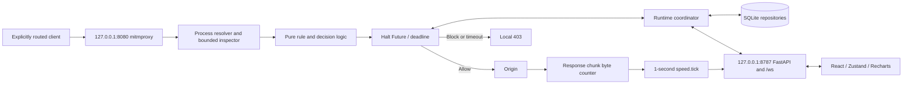

# Implementation architecture

This implementation continues the existing `backend/src/sentriflow` and modular frontend scaffold. `core/` and `inspection/` do not import API/proxy/OS adapters. `runtime.py` is the composition root; `launcher.py` owns lifecycle. Default ports and event names follow `SentriFlow_Build_Plan.md`.

Requests are fully read within the proxy's 8 MiB body bound, inspected and held before application data is forwarded. Responses stream without persistence of content; each received chunk increments measured download counters. The ticker publishes rate samples and flushes active metadata. DNS/TLS negotiation may precede request verdicts; the guarantee concerns HTTP request forwarding, not zero outbound packets of any kind.

Rule precedence: explicit process/exact-host Block, tracker auto-block, saved inspected Allow, Halt triggers, then default Allow. PII, trackers, incomplete inspection and unknown-process large uploads can trigger Halt. Pending capacity is bounded and shutdown/timeout defaults to Block. Stale held rows are marked blocked at restart.

Persistence uses schema version 1, relational identities/indexes and validated JSON details. SQLite stores masked flow metadata, alerts, rules, source domains, score events and public settings. `custom_patterns` is reserved; actual sensitive literals are session-only to avoid plaintext secrets on disk. `process_baseline` is reserved for the deferred extension. The initial schema is mirrored under migrations; upgrades beyond v1 need an explicit migration implementation.

The Windows proxy adapter snapshots WinINET values in a durable journal before mutation. It restores on normal exit; an opt-in-only watchdog observes the owning PID and process creation time for crash recovery. Changes made by another tool are not overwritten blindly. Real OS acceptance remains separate from fake-registry tests.

CA keys are per data directory with restricted ACLs; current-user trust install requires explicit consent. API uses token + peer/Host/Origin checks; WS auth uses an initial frame. Dashboard resources are local, with no telemetry, remote fonts, cloud AI, online GeoIP or map tiles.

References used for implementation: [mitmproxy event hooks](https://docs.mitmproxy.org/stable/api/events.html), [HTTP response stream API](https://docs.mitmproxy.org/stable/api/mitmproxy/http.html), [FastAPI WebSockets](https://fastapi.tiangolo.com/advanced/websockets/).
