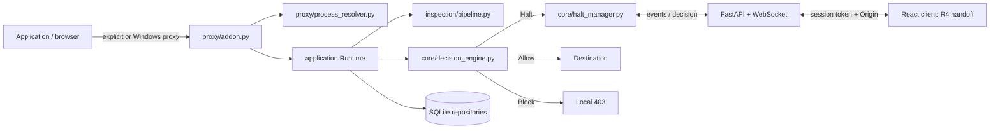

# Implemented backend architecture

Primary target: Windows 11 x64. Python 3.12 runs embedded mitmproxy and FastAPI on the same
asyncio loop. All listeners bind `127.0.0.1`. SQLite stays local in the runtime directory.

`core/` and `inspection/` never import API, proxy or OS adapters. They use shared Pydantic
contracts. `application.py` is the composition root. Repositories use aiosqlite, WAL, foreign
keys and versioned migrations. Version 2 adds dashboard lifecycle, executable identity and
observed-IP fields while retaining schema-v1 history and rules. `runtime.py` and `launcher.py`
are compatibility imports for the same composition root and lifecycle, not separate runtimes.
Unsupported future database versions are rejected.

For each request the addon resolves the client source port, constructs safe metadata, and
passes raw URL/headers/body to inspection in memory. Inspection runs in a worker thread.
Inspection is bounded to 1 MiB of decoded request content. Unsupported encodings, binary
content and decoding/regex limits produce an explicit finding and Halt unless a saved rule
applies. JSON, UTF-8 text, URL-encoded forms, multipart text, gzip and zlib deflate are supported;
Brotli currently produces an uninspectable-content Halt. mitmproxy additionally rejects bodies
above 2 MiB before inspection. Rejected oversized transport flows are not included in the
current request-hook event stream; this is a coverage limit for future R3 integration.

Matching PII, custom strings, uninspectable content, trackers under `ask`, or a large unknown
upload triggers Halt. A matching saved rule takes precedence. Tracker `block` rejects
immediately; tracker `alert` records a finding and permits it unless another trigger applies.

Each Halt has a future and a UTC deadline. Awaiting it suspends only that flow's hook.
No decision, shutdown or a full pending registry results in Block. A per-halt lock accepts
one decision; an `always` choice persists a scoped rule before allowing transmission.
If a timely decision is committing at the deadline, the hold waits for that commit.
No saved rule is written for a once decision. Unknown processes get host-only saved rules.

Blocked requests receive a synthetic 403 before upstream receives their payload. Allowed
requests complete after the response or transport error. The addon persists completion once,
then publishes alerts, flow completion and a score update. Outgoing body bytes count only
after approval. Response headers install a streaming counter; downloaded payload and speed
ticks advance before the response finishes. Response contents are not stored. The chart
excludes network/protocol overhead and traffic outside the proxy.

The event bus has bounded per-client queues. Slow clients disconnect with 1013 and must
reload pending halts and history on reconnect. WebSocket disconnect never releases a hold.
R4's dashboard initializes from the snapshot in the first WS status, unwraps Halt envelopes, and
resynchronizes after reconnects/state changes. Its authentication uses the backend's existing
token/header and WebSocket subprotocol contract. Sensitive pattern definitions remain local
and persistent, with values omitted from the dashboard snapshot.

Only metadata and redacted findings are persisted. Paths become `/[redacted]`; neither raw
headers nor bodies enter public flow models. Custom pattern definitions are intentionally
stored to support future matching. Restrict access to the runtime directory accordingly.

Windows routing saves the exact prior registry values before changes. Startup refuses to
overwrite stale recovery state. Normal shutdown restores before stopping the proxy listener.
An independent process watches the parent PID and creation time for forced termination;
the emergency restore command reuses the same snapshot. Windows behavior still needs
native browser and forced-termination acceptance testing.

TLS handshake failures produce metadata labeled `pinned` for contract compatibility, with
the user-facing explanation “encrypted, not inspected”; pinning is one possible cause.
Upstream certificate validation stays enabled. The CA is generated per runtime directory,
stored with a restricted ACL, and installed/removed only by explicit current-user operations.

The hook follows [mitmproxy's async addon API](https://docs.mitmproxy.org/stable/addons/examples/).
The API uses [FastAPI's WebSocket transport](https://fastapi.tiangolo.com/advanced/websockets/).

The integrated runner owns SIGINT/SIGTERM (and Windows SIGBREAK) so embedded Uvicorn cannot
re-raise a signal before proxy/database/lock cleanup. See [integration.md](integration.md).
