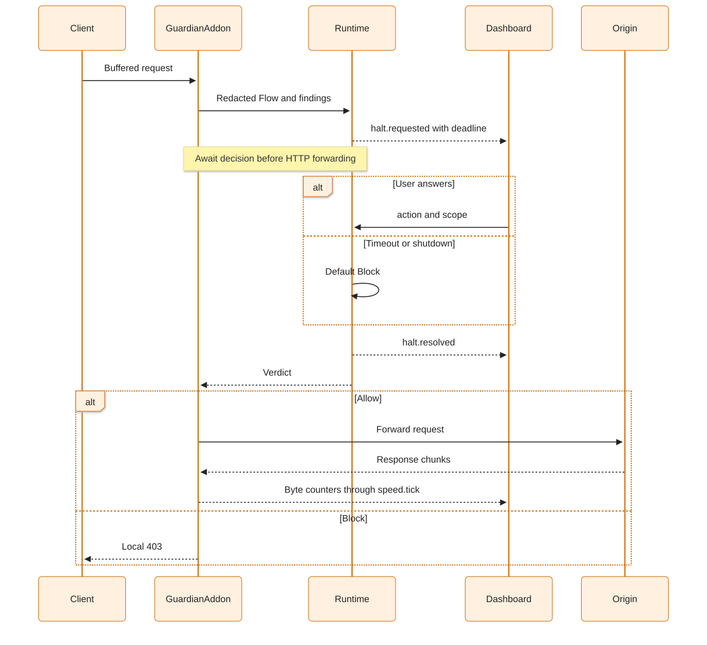
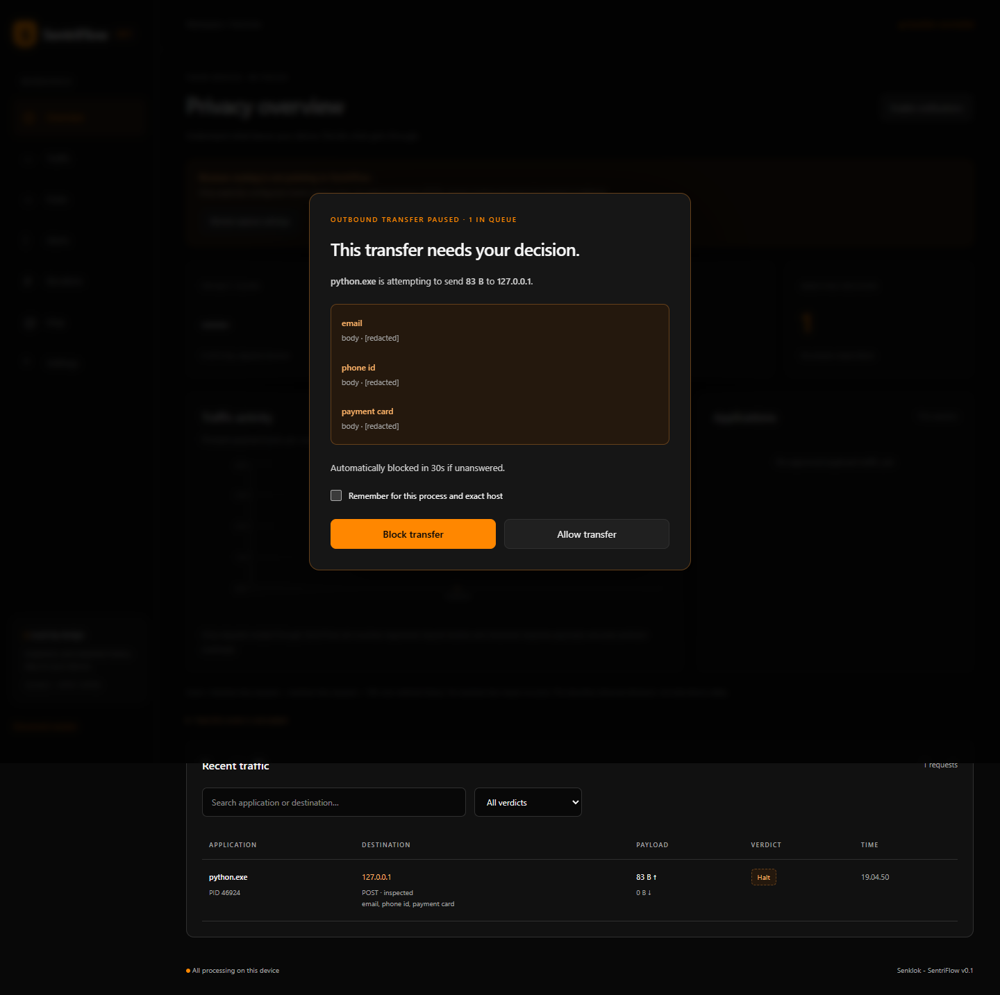
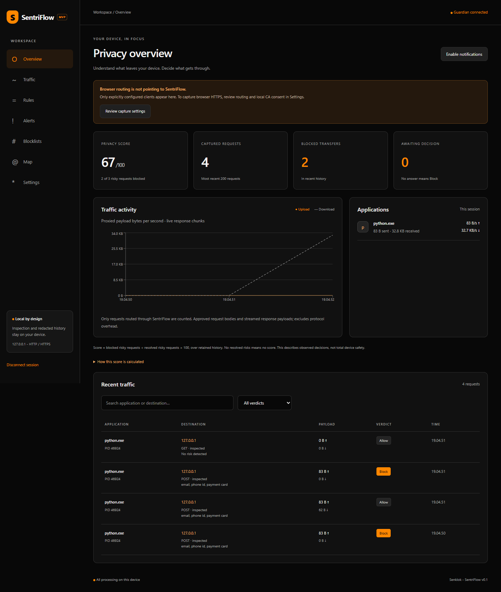
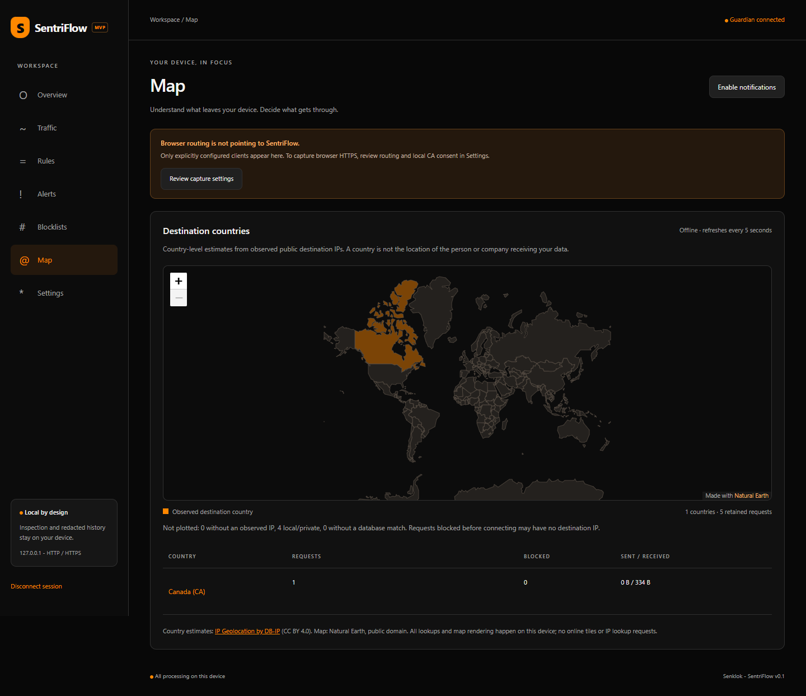

# SentriFlow
## A Local Network Privacy Guardian for Real-Time Visibility and Before-Forward Control

Team Senklok — TECHTONIC UI 3.0 / STASH, October 2026.

Team: Marcel Luther Sitorus (leader, Bandung Institute of Technology), Audric Yusuf Maynard Simatupang, Mahatma Brahmana, Ishak Palentino Napitupulu. Additional affiliations and official submission rules require confirmation. This is a working English draft, not a submission-ready PDF.

## Introduction

Laptop applications send network requests during everyday work, while their owners may struggle to identify which application contacted a destination or whether a transfer includes sensitive content. Encryption protects traffic in transit but also means an authorized local content-inspection tool needs explicit trust configuration and careful handling of plaintext. SentriFlow asks whether a local interface can help a device owner understand and stop a potentially sensitive HTTP request before it is forwarded.

The intended users are students, remote workers, privacy-conscious laptop owners and small teams without a dedicated network analyst. These are target groups, not groups already validated by a survey. Prototype targets are at least 90% named-process attribution during a documented representative capture session, detection of all seeded dummy PII fixtures, and a local decision applied within one second. Targets must be reported separately from actual measurements.

## Problem Analysis

The design hypothesis is that connection metadata alone can leave users unsure about the contents and significance of a transfer, while detailed protocol inspection may require specialist knowledge. The product must connect the process, destination, a bounded content signal and an actionable decision in one workflow. Root causes to investigate include background application behavior, encrypted content, unfamiliar terminology, coarse persistent permissions and the effort of using expert tools.

Application firewalls and protocol analyzers already address important parts of this problem. mitmproxy itself supplies programmable HTTP(S) interception [1]. SentriFlow composes existing techniques into an interface around redacted pattern signals and per-request decisions; it does not claim its interception mechanism is novel or that other tools categorically lack similar capabilities. User-validation questions and competitor comparisons need primary evidence and observed tasks before stronger claims are justified.

## Proposed Solution

The owner explicitly routes a client to a loopback proxy. SentriFlow identifies the client socket's process where possible, scans supported representations for email, Indonesian-phone heuristics, Luhn-valid card candidates and session-sensitive literals, and checks local tracker domains. Risky or incompletely inspected requests enter Halt. The dashboard displays process, host, size and redacted pattern labels. The user can Allow/Block once or remember a process/exact-host decision; silence defaults to Block.

In the local demonstration a client submits a dummy email, phone and test card to a local origin. The real dashboard presents Halt before the payload arrives at the origin. Block produces a local 403; Allow reaches the origin. The history, alerts and disclosed score update. The privacy score is a ratio of risky resolved requests blocked in retained history, not a claim of total device safety.

## System Design

The implementation follows the supplied repository build plan: Python package under `backend/src/sentriflow`, React pages/hooks/stores, loopback proxy 8080 and dashboard/API 8787. Domain logic has no dependency on API/proxy/Windows adapters. A single asyncio process shares the decision coordinator between mitmproxy and FastAPI. Each hold has its own Future and authoritative deadline. WebSocket events communicate flows, holds, scores and a one-second speed ticker.

Architecture, use-case, Halt, ERD and API diagrams are maintained in `diagrams/`. The [API contract](../api.md) and [architecture](../architecture.md) document actual names and deliberate deviations. SQLite stores redacted records, rules, alerts, source domains and public settings. Raw payloads/headers/URL queries are excluded. Sensitive literals are held in memory only. Startup recovers stale held records as blocked.

### Figure 1. System architecture

The control plane and proxy share a single Runtime. Country lookup uses a local database and the destination IP observed on the upstream socket; it does not resolve captured hostnames just to draw the map.

### Figure 2. Owner use cases

The owner can inspect traffic details, manage exact-scope rules, review masked alerts, explore destination countries and explicitly consent to routing or CA trust changes.

### Figure 3. Halt sequence

The authoritative deadline belongs to the backend. The interface countdown explains it; a missing or disconnected interface never turns an unanswered hold into Allow.

### Figure 4. Database relationships

JSON flow records include the observed destination IP and optional country code. The custom-pattern and process-baseline tables are reserved schema; current sensitive literals remain memory-only and the anomaly baseline is not implemented.

### Figure 5. API and event boundary

| Route | Purpose |
| --- | --- |
| `GET /api/snapshot` | Redacted dashboard state and pending holds |
| `GET /api/flows`, `/processes`, `/alerts`, `/score` | Retained request details, session rates and activity indicators |
| `POST /api/halts/{id}/decision` | Allow/Block once or always |
| `GET/POST/DELETE /api/rules` | Manage persistent process/exact-host rules |
| `GET /api/geo/destinations` | Country aggregation from a local MMDB, with unplotted counts |
| `GET/PUT /api/settings`, `GET/POST/DELETE /api/patterns` | Inspection configuration and session literals |
| `/ws` | First-frame authentication, typed events and authoritative snapshots |

DELETE routes use resource IDs. Full request/response shapes and the explicit Windows consent routes are defined in the API document.

## Technical Implementation

mitmproxy provides authorized HTTP/HTTPS interception [1]. The asynchronous request hook waits for the verdict before forwarding the request. Response chunks are counted as they arrive, so download rates can update before response completion [2]; outbound request streaming remains disabled to preserve inspection-before-forward. psutil maps the loopback client endpoint to PID/executable identity, returning Unknown if permissions or process lifetime prevent reliable attribution.

Inspection is bounded to 256 KB. Supported text/JSON/form/XML, gzip/deflate and simple multipart fields are inspected; unsupported formats, Brotli, file uploads or truncation prompt as incomplete. Regex-sensitive patterns are rejected pending a safe bounded implementation. The small included domain list is a demo seed, not a complete threat feed. The behavioral baseline remains future work.

The R4 interface provides upload/download rates per application, searchable traffic and redacted request details, the queued Halt prompt, rule editing/deletion, severity-filtered alerts and a disclosed privacy-score breakdown. The responsive black-and-papaya-orange layout uses local assets only. An unsuccessful decision remains visible inside the Halt dialog, and uninspected requests cannot be remembered as Allow.

Destination countries are rendered with Leaflet [4] and bundled Natural Earth shapes [5]. Country estimates are read from a local DB-IP Lite country MMDB [6]. The map groups retained requests, distinguishes blocked transfers and payload sizes, and accounts for private, unobserved or unmatched IPs. It never contacts an online tile server or an IP lookup service. These approximate IP-country assignments are not evidence of a recipient's nationality, identity or physical location. DB-IP attribution and data provenance are included with the map.

The API requires per-run session token, local peer and accepted Host/Origin. WebSocket authentication occurs in the first frame rather than a logged URL [3]. CA keys are generated per private data directory; trust install is explicit. Upstream certificate verification remains enabled. Windows routing is opt-in with a durable original-settings journal, normal-exit restore and a hidden watchdog for dead-session recovery. Fake-registry tests validate the logic; real Windows recovery acceptance remains necessary.

Local tests cover PII/redaction, Luhn, domain boundaries, rule scope, timeout/parallel holds, persistence/recovery, API/WS access and real HTTP/HTTPS non-delivery/release. A dedicated test confirms positive download counter/rate while the origin deliberately holds the remaining response. Actual Edge UI checks and screenshots are linked below.

The map screenshot comes from an explicit non-personal test request to example.com through the proxy. Geography uses the observed server IP and a local database; the browser itself made no external tile or lookup requests. IP routing and dataset changes can alter the country shown in a future run.

Measured evidence is in [local-demo-report.json](../evidence/local-demo-report.json): three local dummy requests, detected pattern labels, named attribution and click-to-response timing. This small controlled sample establishes feasibility; it does not demonstrate representative user behavior, universal detection or a production safety guarantee.

## Expected MVP, Impact and Plan

Core capture/inspection/Halt/rules/history/dashboard and the offline destination map are implemented. Remaining acceptance work is a clean Windows 11 installation, representative multi-app session, real normal/forced-crash routing restoration, detector false-positive review, compatibility/pinning/QUIC tests, long-run stability and notification delivery. Anomaly work follows core reliability. Kernel filtering, mobile support, installer and a trained PII model remain out of scope.

| R4 deliverable | Implementation and review evidence |
| --- | --- |
| Dashboard and traffic | React/Zustand, real WebSocket events, per-application rates, filters and request detail |
| Halt and rules | Countdown, queued holds, Allow/Block once/always, rule editing/deletion, visible decision errors |
| Alerts and score | High-priority PII labels, redaction, severity filter and disclosed block-ratio calculation |
| Offline country map | Local MMDB plus bundled vector countries, explicit unknown-IP accounting and accessible country table |
| Proposal package | Consistent cover, five exported diagram sets, local HTML and A4 PDF working draft |

Impact hypotheses are improved user comprehension of application/destination/pattern signals and the ability to prevent a demonstrated dummy transfer. Measure task success, explanation accuracy, decision time, unanswered prompts and disruption with consented participants. Do not claim breach reductions or legal compliance from this prototype. Research data and quotes have not yet been collected.

The remaining plan is acceptance/stabilization first, consented validation and source review second, then independent proposal review, rehearsal and backup video. A reviewable draft PDF and diagram exports are generated from local sources. Dates, rubric weights and the suggested 15-page cap from the tracker are planning inputs until confirmed by official organizer material. The draft has not been submitted; user-validation findings and official-rule review must precede a submission-ready version.

| Risk | Mitigation / boundary |
| --- | --- |
| Proxy bypass / QUIC | Document capture scope; test selected browser routing and fallback before demo |
| Trust/pinning failure | Mark uninspected; no pinning bypass or blanket TLS verification disable |
| False positives / prompt fatigue | Bounded inspection, transparent labels, exact-scope rules, participant testing |
| Unanswered prompt | Short authoritative timeout and default Block |
| CA or activity metadata exposure | Restricted local directory, redaction, explicit trust removal |
| Broken system proxy | Durable snapshot, restore/watchdog, external-change checks and emergency command |
| Demo/network failure | Offline origin, automated local tests, genuine screenshots; backup recording pending |

## References

[1] mitmproxy contributors, “Event Hooks,” mitmproxy Documentation. [Online]. Available: https://docs.mitmproxy.org/stable/api/events.html. [Accessed: Oct. 27, 2026].

[2] mitmproxy contributors, “HTTP API,” mitmproxy Documentation. [Online]. Available: https://docs.mitmproxy.org/stable/api/mitmproxy/http.html. [Accessed: Oct. 27, 2026].

[3] FastAPI, “WebSockets,” FastAPI Documentation. [Online]. Available: https://fastapi.tiangolo.com/advanced/websockets/. [Accessed: Oct. 27, 2026].

[4] Leaflet contributors, “API Reference,” Leaflet 1.9.4. [Online]. Available: https://leafletjs.com/reference.html. [Accessed: Oct. 27, 2026].

[5] Natural Earth, “Terms of Use.” [Online]. Available: https://www.naturalearthdata.com/about/terms-of-use/. [Accessed: Oct. 27, 2026].

[6] DB-IP, “IP to Country Lite,” October 2026 edition, CC BY 4.0. [Online]. Available: https://db-ip.com/db/download/ip-to-country-lite. [Accessed: Oct. 27, 2026].
